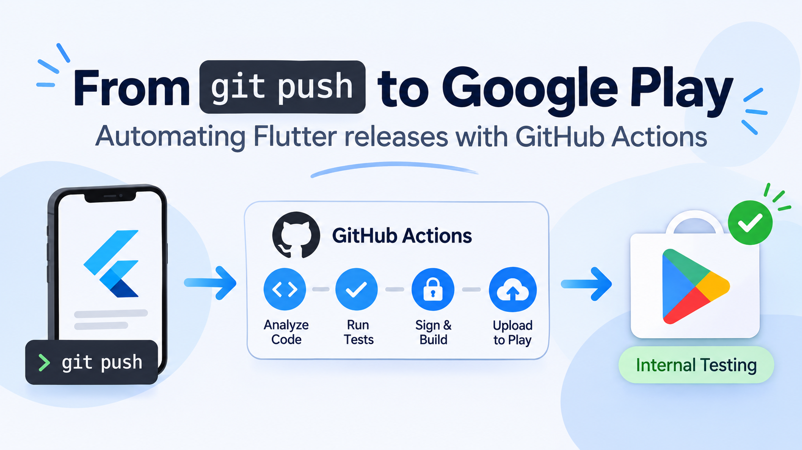
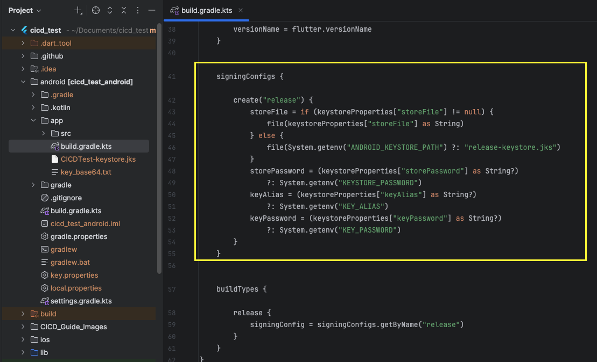
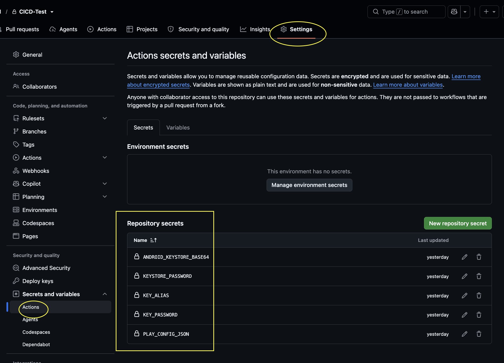
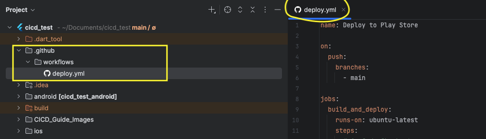
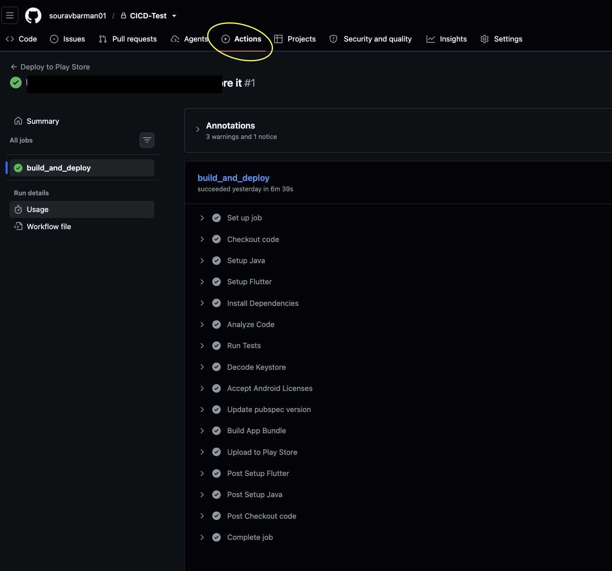

# I Got Tired of Uploading Flutter Builds by Hand, So I Let GitHub Do It



*How I set up a pipeline that takes my Flutter app from `git push` to the Google Play internal track, and the mistakes I made along the way.*

---

Every Android release I did used to go the same way.

Pull the latest code. Run the tests (if I remembered). Open `pubspec.yaml` and bump the build number. Build the signed bundle. Open Play Console, find the right app, drag the `.aab` in, pick a track, write something in the release notes, and hit save.

None of it is hard. But it takes time, and it's easy to get wrong. More than once I uploaded a bundle, Play Console told me the version code had already been used, and I had to go back to the start.

So I gave myself a small challenge: **can one `git push` take a Flutter app all the way to the Play Store with nothing done by hand?**

It can. It took me an afternoon, plus a few hours of being confused by Google Cloud. Here's how I did it.

---

## What the pipeline does

Every time I push to `main`, GitHub Actions starts a fresh Ubuntu machine and does this:

```
  git push (main)
        │
        ▼
┌─────────────────────────────────────────────┐
│           GitHub Actions Runner             │
│                                             │
│   1. Checkout code                          │
│   2. Set up Java 17 and Flutter             │
│   3. flutter pub get                        │
│   4. flutter analyze        ── quality gate │
│   5. flutter test           ── quality gate │
│   6. Decode keystore from secret            │
│   7. Accept Android SDK licenses            │
│   8. Bump build number                      │
│   9. flutter build appbundle --release      │
│  10. Upload .aab to Google Play             │
└─────────────────────────────────────────────┘
        │
        ▼
  Google Play Console → Internal testing track
```

The part I like most is steps 4 and 5. If the analyzer complains or a test fails, the run stops before anything is signed or uploaded. Broken code never reaches my testers.

A full run takes about six and a half minutes. I push, go and make tea, and when I come back the build is waiting in the internal testing track.

**My setup:** Flutter 3.44.2 (stable), Java 17, Gradle Kotlin DSL, GitHub Actions on `ubuntu-latest`, and the [`r0adkll/upload-google-play`](https://github.com/r0adkll/upload-google-play) action for the upload.

Now the steps.

---

## Step 1: Sort out app signing

Google Play only accepts bundles signed with your upload key. On my laptop that's simple, because the keystore is sitting right there. On a CI runner it's a problem, because **the keystore and its passwords can never go into the repo.**

### Create the keystore

If you don't have one yet:

```bash
keytool -genkey -v \
  -keystore android/app/upload-keystore.jks \
  -keyalg RSA -keysize 2048 -validity 10000 \
  -alias upload
```

### Turn it into text

GitHub Secrets only store text, and a `.jks` file is binary. The usual trick is to Base64-encode it:

```bash
base64 -i android/app/upload-keystore.jks | pbcopy   # macOS: copies it to the clipboard
```

Hold on to that output. It goes into GitHub in Step 3.

A warning from experience: I first saved the Base64 output to a text file inside the project, and it ended up in a commit. An encoded keystore is still your keystore. If you save it to a file, add that file to `.gitignore` **before** you do anything else, and delete it once you've copied it.

### Make Gradle work in both places

I wanted `android/app/build.gradle.kts` to work on my machine and in CI without any changes. So it:

- reads `key.properties` when that file exists (locally, and git-ignored), and
- falls back to environment variables when it doesn't (in CI, filled from GitHub Secrets).



*Each signing value comes from `key.properties` if it's there, and from an environment variable if not.*

That way there's one signing setup, and no secret lives in the code.

### Keep it out of Git

In `android/.gitignore`:

```gitignore
key.properties
**/*.keystore
**/*.jks
key_base64.txt
```

---

## Step 2: Let GitHub talk to Google Play

This was the part that took me the longest, mostly because it happens across two different consoles.

The pipeline needs its own identity to upload builds. In Google's world that's a **service account**: a robot user with its own email address and private key. You create it in Google Cloud, then invite it into Play Console like a teammate.

```
Google Cloud Console                          Google Play Console
┌──────────────────────────────┐              ┌──────────────────────────────┐
│ 1. Select project            │              │ 5. Invite service account    │
│ 2. Enable Play Developer API │  ── email ─▶ │    email as a user           │
│ 3. Create service account    │              │ 6. Grant app permissions     │
│ 4. Create JSON key ──────────┼──┐           └──────────────────────────────┘
└──────────────────────────────┘  │
                                  └─▶ GitHub Secret: PLAY_CONFIG_JSON
```

### 2.1 Pick a Google Cloud project

Go to [console.cloud.google.com](https://console.cloud.google.com), sign in with the account that owns your Play developer account, and pick a project (or create one). Make sure it's selected in the top bar before you go on.

### 2.2 Turn on the Play Developer API

This one caught me out. The **Google Play Android Developer API** is off by default in every project, and the error you get when it's off doesn't tell you much.

Go to **APIs & Services → Library**, search for *Google Play Android Developer API*, and click **Enable**. Or from the terminal:

```bash
gcloud services enable androidpublisher.googleapis.com --project=<your-project-id>
```

The API, the service account and the key all need to be in the **same** project. If they aren't, you'll see `API has not been used in project … or it is disabled`.

### 2.3 Create the service account

Go to **IAM & Admin → Service Accounts → Create service account**. I called mine `flutter-ci-cd-service`. You can skip the "grant this service account access to project" step, because Play permissions are set in Play Console, not in Google Cloud.

When it's created, copy its email address. You'll need it in a minute.

### 2.4 Download a JSON key

Open the service account, go to the **Keys** tab, then **Add key → Create new key → JSON**. A file downloads.

Treat that file like a password. It's the only copy, and anyone who has it can upload builds of your app. It goes into GitHub Secrets in Step 3, and then I'd delete it from your Downloads folder.

(If key creation is blocked, your Google Workspace organization probably has the `iam.disableServiceAccountKeyCreation` policy turned on. An admin has to allow it for your project.)

### 2.5 Invite the robot into Play Console

In [Play Console](https://play.google.com/console), go to **Users and permissions** at the account level (not inside an app), and click **Invite new users**. Paste the service account email. It's the same as the `client_email` field in the JSON file.

### 2.6 Give it only what it needs

Under **App permissions**, add just your app and turn on:

- View app information (read-only)
- Release apps to testing tracks
- Manage testing tracks and edit tester lists
- Release to production (only if you want the pipeline to ship to production)

You *could* give it account-wide permissions, but then it can touch every app you own. One app is enough.

Service accounts don't need to accept the invite. If your first run says `The caller does not have permission`, wait a few minutes. It took a while for mine to start working.

### 2.7 Upload the first build by hand

This surprised me: **the Play API can only update an app that already exists.** It can't create one. So before your first pipeline run, create the app in Play Console, build a signed bundle locally, upload it once to internal testing yourself, and fill in the required app setup (privacy policy, content rating, and so on).

After that, the pipeline handles every upload.

---

## Step 3: Add the secrets to GitHub

In your repo, go to **Settings → Secrets and variables → Actions** and add five secrets:

| Secret | What goes in it |
|---|---|
| `ANDROID_KEYSTORE_BASE64` | The Base64 text from Step 1 |
| `KEYSTORE_PASSWORD` | Your keystore password |
| `KEY_ALIAS` | Your key alias (e.g. `upload`) |
| `KEY_PASSWORD` | Your key password |
| `PLAY_CONFIG_JSON` | The whole JSON key file, curly braces included |



*Only the names show up here. GitHub never shows a secret's value again after you save it.*

GitHub encrypts these, hides them in the logs, and doesn't pass them to workflows started from forks.

---

## Step 4: Write the workflow

Create `.github/workflows/deploy.yml`:



Here's the whole thing:

```yaml
name: Deploy to Play Store

on:
  push:
    branches:
      - main

jobs:
  build_and_deploy:
    runs-on: ubuntu-latest
    steps:
      - name: Checkout code
        uses: actions/checkout@v4

      - name: Setup Java
        uses: actions/setup-java@v4
        with:
          distribution: 'zulu'
          java-version: '17'

      - name: Setup Flutter
        uses: subosito/flutter-action@v2
        with:
          flutter-version: '3.44.2'
          channel: 'stable'

      - name: Install Dependencies
        run: flutter pub get

      - name: Analyze Code
        run: flutter analyze

      - name: Run Tests
        run: flutter test

      - name: Decode Keystore
        run: echo "${{ secrets.ANDROID_KEYSTORE_BASE64 }}" | base64 --decode > android/app/upload-keystore.jks

      - name: Accept Android Licenses
        run: yes | $ANDROID_HOME/cmdline-tools/latest/bin/sdkmanager --licenses || true

      - name: Update pubspec version
        run: |
          VERSION=$(grep 'version:' pubspec.yaml | awk '{print $2}')
          NAME=$(echo $VERSION | cut -d+ -f1)
          BUILD=$(echo $VERSION | cut -d+ -f2)
          NEW_BUILD=$((BUILD+1))
          sed -i "s/version: $VERSION/version: $NAME+$NEW_BUILD/" pubspec.yaml

      - name: Build App Bundle
        run: flutter build appbundle --release
        env:
          ANDROID_KEYSTORE_PATH: upload-keystore.jks
          KEYSTORE_PASSWORD: ${{ secrets.KEYSTORE_PASSWORD }}
          KEY_ALIAS: ${{ secrets.KEY_ALIAS }}
          KEY_PASSWORD: ${{ secrets.KEY_PASSWORD }}

      - name: Upload to Play Store
        uses: r0adkll/upload-google-play@v1
        with:
          serviceAccountJsonPlainText: ${{ secrets.PLAY_CONFIG_JSON }}
          packageName: com.yourcompany.yourapp
          releaseFiles: build/app/outputs/bundle/release/app-release.aab
          track: internal # internal | alpha | beta | production
```

A few notes on the less obvious steps:

- **Decode Keystore** rebuilds the `.jks` from the secret. It only exists on the runner, which is thrown away when the job ends.
- **Accept Android Licenses** stops the build from hanging on an SDK licence prompt that nobody is there to answer.
- **Update pubspec version** bumps `1.0.0+5` to `1.0.0+6` so Play doesn't reject the upload for reusing a version code.
- **packageName** has to match your app's `applicationId` exactly.

---

## Step 5: Push and watch

```bash
git add .
git commit -m "Add CI/CD pipeline"
git push origin main
```

Open the **Actions** tab in your repo and you'll see the run start. Each step has its own logs, which helps a lot when something breaks.



*My first fully green run: checkout to Play Store upload in 6 minutes 39 seconds.*

When it's done, go to **Play Console → Testing → Internal testing**. The new release is there, ready for testers.

I'll admit I refreshed that page a few times before I believed it.

---

## What went wrong (so you can skip it)

It didn't work first time. Here's what broke, roughly in order:

1. **Signing worked locally but failed in CI.** My Gradle file only read `key.properties`, which doesn't exist on the runner. Adding the environment-variable fallback fixed it.
2. **I couldn't store the keystore as a secret.** Secrets are text only. Base64 solved that.
3. **I committed the Base64 keystore.** The encoded file was in the project folder and got picked up by `git add .`. I untracked it and added it to `.gitignore`. Deleting a file in a new commit doesn't remove it from history, though. If your repo is or ever was public, purge it with something like `git filter-repo` and **rotate the key**.
4. **"API has not been used in project… or it is disabled."** I hadn't enabled the Play Developer API. See Step 2.2.
5. **"Version code has already been used."** Every upload needs a higher version code. That's why the bump step exists.
6. **Package name mismatch.** I'd left the default `com.example.*` ID from `flutter create`. I had to rename `namespace`, `applicationId` and the package of `MainActivity.kt` to match the app in Play Console.

---

## A few things I'd tell myself at the start

- **Make quality checks a gate.** Analyze and test before you sign anything. It costs a minute and has already stopped me shipping a broken build.
- **Pin your versions.** A fixed Flutter and Java version means today's build behaves like last week's.
- **Signing material never touches Git.** Use `.gitignore` locally and encrypted secrets in CI, every time.
- **Least privilege for the robot.** One app and only the permissions it needs.
- **Ship to internal testing first.** Promote to beta or production once real people have tried the build.

---

## What I'm doing next

The pipeline works, but there's more I want to add:

- **Build numbers that survive.** Right now the bump only changes `pubspec.yaml` on the runner and never commits it back. Passing `--build-number=${{ github.run_number }}` to the build is simpler and always goes up.
- **Separate CI from CD.** Run analyze and test on every pull request, and only deploy when code is merged to `main` or a version tag is pushed.
- **Caching.** Caching Flutter and Gradle dependencies should cut a good chunk off the run time.
- **iOS.** TestFlight with Fastlane or the App Store Connect API is next on the list.
- **Notifications.** A Slack message when a build lands, plus release notes generated from commit messages.

---

## Wrapping up

The main thing I took away is that the YAML is the easy part. Most of the work, and most of the risk, is in handling secrets: the keystore, the passwords, and the service account key. Get those right and everything else is straightforward.

Now every release goes through the same steps, nothing depends on my memory, and a failing test blocks a release within a few minutes.

If you're still uploading builds by hand, give it a try. The setup takes an afternoon, and you get that time back after a few releases.

If you have questions or have built something similar, I'd like to hear about it in the comments.

*Sourav Barman, Flutter Developer*

`#Flutter` `#CICD` `#GitHubActions` `#AndroidDevelopment` `#MobileDevelopment`
